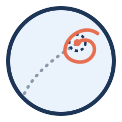

<p align="center">
  
</p>

<h1 align="center">probebehavior</h1>

<p align="center">Water maze probe tests aligned on the <b>first arrival at the empty goal</b>.</p>

<p align="center">
  <a href="https://github.com/RodrigoOrvate/probebehavior/actions/workflows/tests.yml"></a>
  <a href="https://pypi.org/project/probebehavior/"></a>
  
  <a href="https://github.com/RodrigoOrvate/probebehavior/blob/main/LICENSE"></a>
  <a href="https://doi.org/10.5281/zenodo.23888805"></a>
</p>

In a probe test the platform is gone. The first time the animal reaches its former location is the moment its
expectation is violated. Standard probe measures (time in the target quadrant, crossings, proximity) summarise the whole
test; strategy classifiers such as Rtrack are trained on trials that end at the platform. `probebehavior` splits each
probe at the first arrival and describes the search that follows.

## Measures after the first arrival

For each probe, with the default settings:

| Column | Meaning |
|---|---|
| `reached` | whether the animal entered the goal at all |
| `arrival_latency_s` | time of the first entry into the goal |
| `path_efficiency` | straight-line distance from the start to the goal edge divided by the path swum until arrival |
| `persistence` | fraction of the 15 s after arrival spent within 20 cm of the goal centre |
| `reentries` | entries into the goal in those 15 s, after the first |
| `first_stay_s` | time from arrival until the animal first leaves the 20-cm zone |
| `mean_distance` | mean distance to the goal in those 15 s |
| `speed` | path length in those 15 s divided by their duration |
| `turning_deg_s` | mean absolute heading change per second while swimming, in those 15 s |
| `wall_latency_s` | time from arrival to the first entry into the wall band (outer 20% of the radius), within 30 s |
| `wall_censored` | true when the wall band was not reached within 30 s |
| `other_locations_visits` | visits to the goal location rotated by 90°, 180° and 270° (other quadrants), within 30 s |
| `window_s` | length of the window actually used (only differs from 15 s with `partial_window`) |

Measures that need a full window after arrival are left empty when the probe ends first; with
`Settings(partial_window=True)` late arrivals use the time left instead (at least `min_window`). Aligned curves (distance
to goal, distance to wall, speed) are returned on a 1-s grid from 5 s before to 30 s after arrival. All windows, radii and
the probe length are settings.

## Classic measures, also split at the arrival

`classic_measures` returns the usual probe measures for the whole probe and separately before (`_pre`) and after
(`_post`) the first arrival:

| Column | Meaning |
|---|---|
| `quadrant_pct` | % of time in the target quadrant, centred on the goal (within 45° of its direction), as in Rtrack |
| `proximity` | mean distance to the goal (Gallagher proximity) |
| `crossings` | entries into the goal (in `_post`, the re-entries after the first arrival) |
| `thigmotaxis_pct` | % of time in the wall band |
| `duration_s` | length of the segment |

`measure_experiment` adds them to every row (turn off with `classic=False` or `--no-classic`).

## Strategies before the arrival, with Rtrack

Before the first arrival a probe is trial-like, which is where Rtrack's strategy calls apply. `export_pre_arrival`
writes each probe up to and including the first arrival (whole probe when the goal is never reached) with an Rtrack
experiment table, so Rtrack can classify that part while `probebehavior` describes the rest.

## Use

```python
import probebehavior as pb

arena = pb.read_rtrack_arena('arenas/day8.txt')          # or pb.Arena((0, 0), 100, (42.3, 37.6), 6)
track = pb.read_track('tracks/rat01_PT1.csv')
metrics, curves = pb.measure(*track, arena)
classic = pb.classic_measures(*track, arena)
```

Many probes at once, from an Rtrack experiment table (`_TrackID`, `_Arena`, `_TrackFile`, plus any other columns):

```
probebehavior experiment.csv --out probes.csv --curves curves.csv --export-pre-arrival for_rtrack/
```

Tracks are delimited text with time (s) and x, y in the arena units (cm); arenas use the Rtrack description
(`arena.bounds = circle cx cy r`, `goal = circle gx gy r`), so the same files serve both tools.

## Download and install

With pip, from PyPI:

```
pip install probebehavior
```

A given version, as used in a paper:

```
pip install probebehavior==0.1.1
```

Version 0.1.1 has the same code as 0.1.0 (only the package metadata changed). The development version comes straight
from GitHub: `pip install git+https://github.com/RodrigoOrvate/probebehavior`.

Or download the source of any release from the [releases page](https://github.com/RodrigoOrvate/probebehavior/releases) or
its archived copy on [Zenodo](https://doi.org/10.5281/zenodo.23888805), and run `pip install .` in the unpacked
folder. From a clone, with the tests:

```
pip install -e ".[test]"
pytest
```

## Availability

| | |
|---|---|
| Source code | https://github.com/RodrigoOrvate/probebehavior |
| Archived releases | Zenodo, [doi:10.5281/zenodo.23888805](https://doi.org/10.5281/zenodo.23888805) (all versions; each version also has its own DOI) |
| Requirements | Python 3.9 or later, NumPy, pandas |
| Tested on | Python 3.9, 3.11 and 3.13 (GitHub Actions, every push) |
| License | MIT |
| Issues and questions | https://github.com/RodrigoOrvate/probebehavior/issues |

## Citation

If you use probebehavior, please cite it:

> Orvate R, Cammarota M (2026). probebehavior: water maze probe tests aligned on the first arrival at the empty goal.
> Zenodo. https://doi.org/10.5281/zenodo.23888805

This DOI always resolves to the latest version; the Zenodo page lists the DOI of each version, for citing the exact one
you used. GitHub's "Cite this repository" button reads `CITATION.cff`.

## License

MIT.
